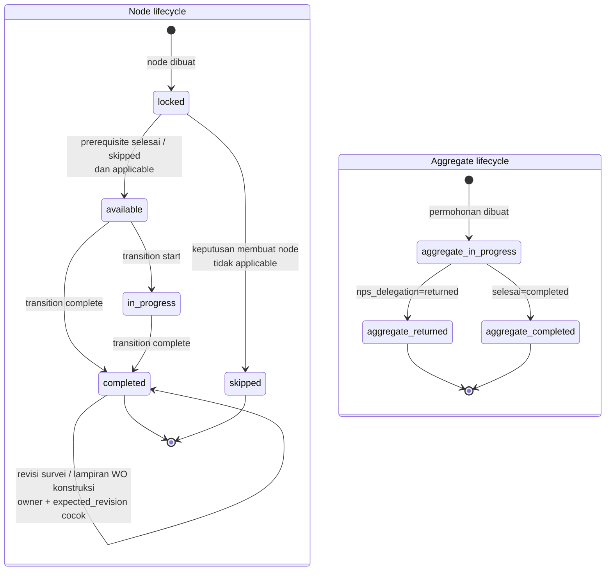

# Workflow State

**Status:** Implementasi branch dev, 26 Oktober 2026
**Perspektif:** Semua jenis sambungan

Status node dihitung ulang dari fakta persisted dan dependency graph. `CurrentStage`
adalah proyeksi presentasi dan bukan transition gate.

`returned` dan `completed` bersifat terminal untuk transisi workflow. Revisi survei
atau lampiran upload WO Konstruksi tetap diizinkan pada node completed, termasuk
aggregate terminal, melalui endpoint revisi terpisah. Revisi tidak membuka ulang
node, mengubah keputusan, completion, deadline, atau status aggregate.

Node `completed` atau `skipped` dapat memenuhi prerequisite. Skip hanya sah untuk
cabang yang tidak applicable atau prioritas historis yang dikecualikan migrasi
setelah NPS. `wo_app` dan `pk_vendor` hanya riwayat, bukan node aktif.

`energize_status=temporary|permanent` adalah substatus hasil pengoperasian jaringan,
bukan status aggregate baru. Keduanya menyelesaikan node energize; closing tetap
menunggu `energize_jaringan` dan `pemasangan_sr_app`. `CurrentStage` mengambil tahap
terendah yang belum selesai, sehingga tidak menghalangi cabang paralel tahap lain.
