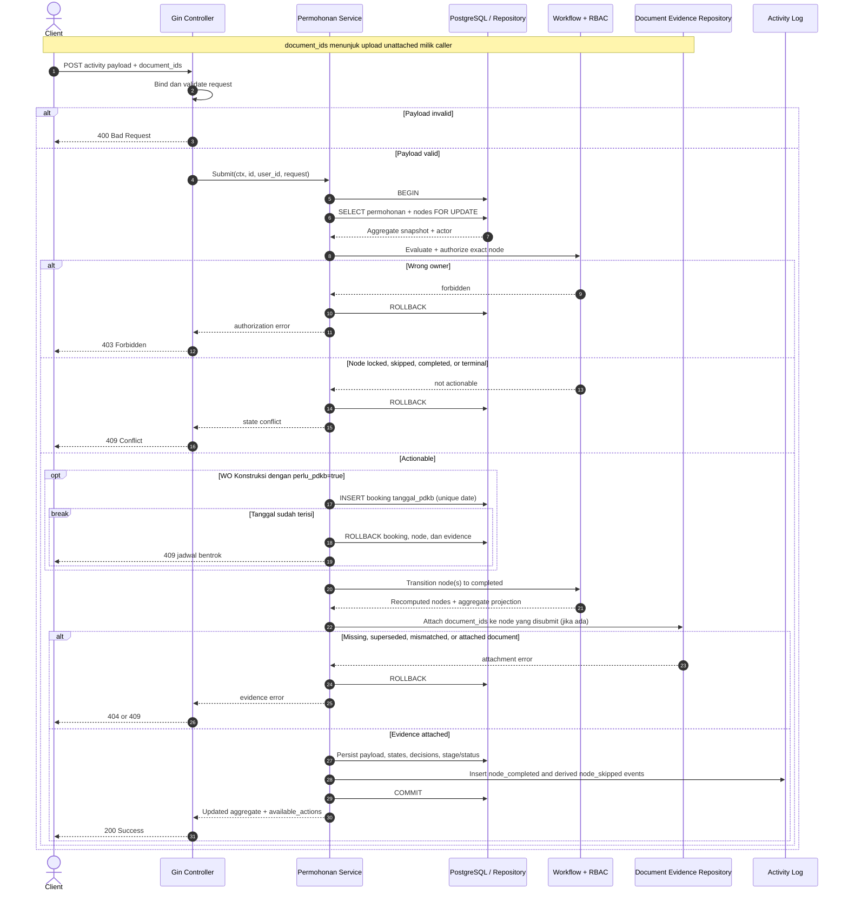

# Activity Submission Sequence

**Status:** Implementasi branch dev, 26 Oktober 2026
**Perspektif:** Semua endpoint penyelesaian activity

Dokumen sudah di-upload dan divalidasi (serta dipindai jika ClamAV aktif) sebelum
submission. Penyelesaian node, attachment
evidence, aggregate projection, dan audit log berada dalam satu transaksi database.

Bundled endpoints yang memiliki owner sama menjalankan transisi node dalam dependency
order dan hanya menyimpan hasil akhir setelah seluruh validasi berhasil. Reservasi
material dan tera APP adalah dua submission terpisah karena owner-nya berbeda.
Verifikasi prioritas tidak memerlukan evidence; catatan opsional. Penyelesaian WO
Konstruksi dan booking kalender harus commit bersama.

Revisi memakai endpoint PUT terpisah: lock aggregate, periksa role/unit pemilik,
node completed, dan `expected_revision`; simpan payload/pilihan dokumen lama,
perbarui pilihan evidence upload saat ini, naikkan revision, lalu commit audit.
Konflik menghasilkan 409 dan rollback. Completion, SLA, keputusan, dan status
aggregate tidak dihitung ulang oleh revisi.
