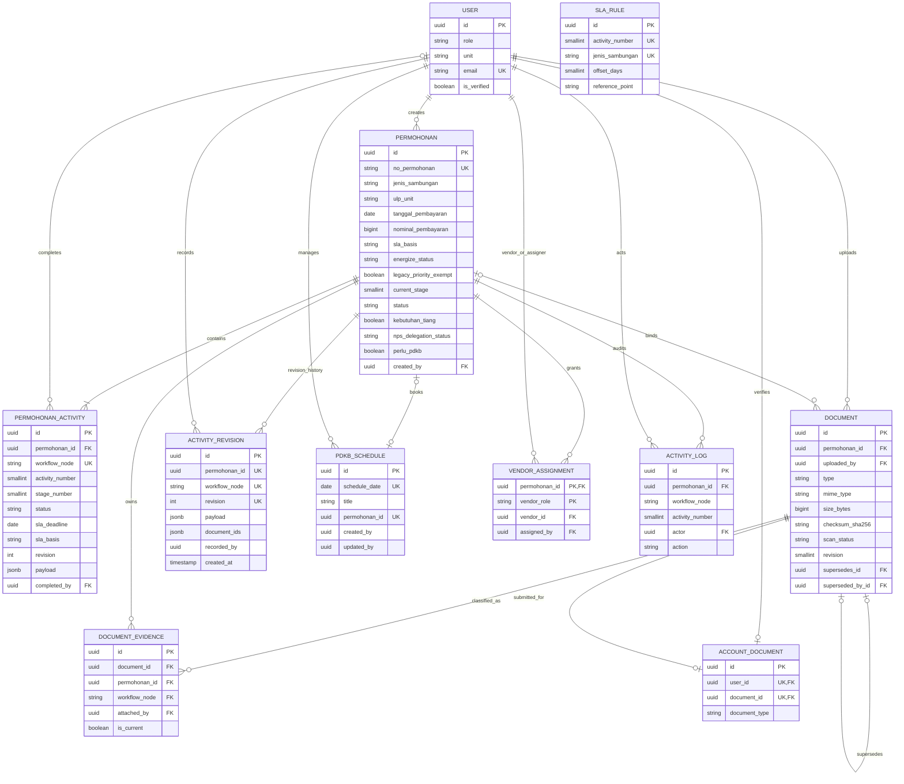

# Data Model

**Status:** Implementasi branch dev, 26 Oktober 2026
**Perspektif:** Entity workflow, evidence, assignment, SLA, dan audit

`SLA_RULE` dipilih secara logis memakai `(activity_number, jenis_sambungan)`; tidak ada
foreign key langsung dari workflow node. Constraint evidence memastikan dokumen dan
node berasal dari permohonan yang sama. Satu dokumen dapat menjadi evidence untuk
beberapa node melalui beberapa row `DOCUMENT_EVIDENCE`.

`ACTIVITY_REVISION` menyimpan snapshot payload dan ID dokumen lama, bukan salinan
file. Identitas uniknya `(permohonan_id, workflow_node, revision)`. Relasi pada
entity revisi/jadwal menunjukkan asosiasi logis; tidak menambahkan foreign key
fisik yang tidak dideklarasikan entity. Evidence lama tetap tersimpan dengan
`is_current=false`; file generated tetap pada association semula.

`PDKB_SCHEDULE.schedule_date` unik untuk satu tim/satu tanggal. `permohonan_id`
null berarti kegiatan manual; nilai terisi berarti booking WO yang terkunci.
`payment_workdays_v1` membedakan SLA pembayaran/hari kerja dari `calendar`
historis; migrasi tidak mengganti deadline lama.
