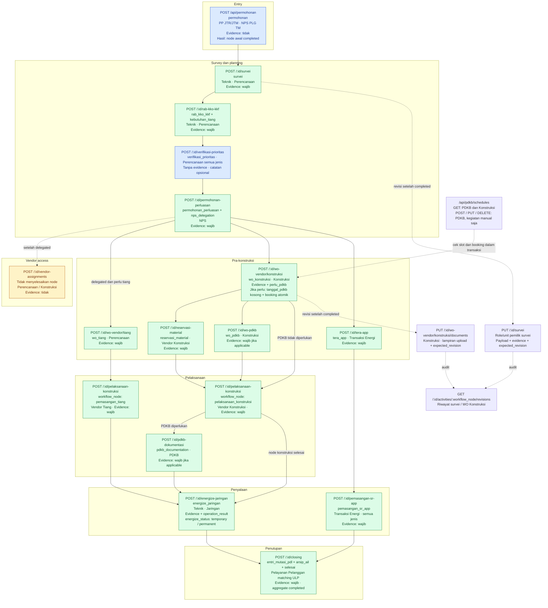

# API Action Map

**Status:** Implementasi branch dev, 26 Oktober 2026
**Perspektif:** Authenticated write endpoints

Setiap activity submission mengembalikan aggregate terbaru dan caller-specific `available_actions`.
Wrong owner menghasilkan 403; node yang tidak actionable menghasilkan 409.

Perluasan dan delegasi NPS disubmit atomik. Hanya outcome `delegated` membuka
cabang berikutnya; `returned` menghentikan workflow. Panah masuk ke node workflow
menyatakan seluruh prerequisite, dengan skip sah untuk tiang/PDKB yang tidak perlu.
Diagram merangkum endpoint; dependency lengkap ada pada diagram per jenis.

PUT revisi tidak menyelesaikan ulang node atau mengubah SLA; tetap diizinkan
setelah closing/returned. Revision usang atau booking tanggal bentrok menghasilkan
409. Endpoint penyelesaian WO APP sudah dihapus dari routes aktif. Tanggal dan
nominal pembayaran wajib saat membuat permohonan baru.

Prefix `/api/permohonan` berlaku untuk semua path `/:id/...`; kalender memakai
prefix tersendiri seperti ditulis pada diagram. PUT/DELETE kalender menambahkan
`/:schedule_id`. GET riwayat tetap mengikuti read scope permohonan/activity.
