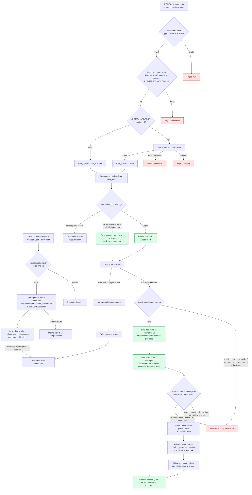

# Evidence Lifecycle

**Status:** Implementasi branch dev, 26 Oktober 2026
**Perspektif:** Dokumen private dan association ke workflow node

Object key, original filename, customer data, dan storage credential tidak ditulis ke
activity log. Jika persistence upload gagal setelah object dibuat, service mencoba
menghapus object sebagai kompensasi.

Revisi attachment berlaku hanya pada survei dan lampiran upload WO Konstruksi,
termasuk setelah aggregate completed/returned. File dan evidence historis tidak
dihapus. PDF WO generated serta association node lain tidak berubah; superseding
upload unattached berbeda dari memilih ulang evidence melalui endpoint revisi.

Survei tetap memerlukan minimal satu evidence. Kategori izin pemilik tanah,
perangkat desa, atau gabungan keduanya tersedia dan opsional. Batas per file
30 MiB; XLSX diterima dengan pemeriksaan isi/MIME, termasuk untuk RAB/KKO/KKF.
