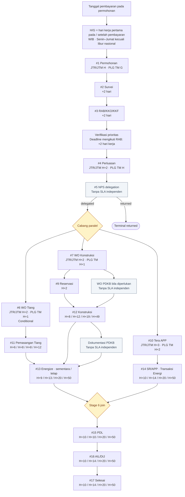

# SLA and Critical-Path View

**Status:** Implementasi branch dev, 26 Oktober 2026
**Perspektif:** Semua jenis sambungan

SLA permohonan baru memakai tanggal pembayaran dan basis `payment_workdays_v1`.
Dependency graph tetap menentukan node yang dapat dijalankan; deadline tidak
menjadi transition gate. Semua panah masuk adalah prerequisite bersama, dengan
skip sah untuk cabang tiang/PDKB yang tidak applicable.

Urutan nilai yang dipisahkan `/` adalah JTR, JTM/Gardu, PLG TM &lt;5 GWNG, dan
PLG TM &gt;5 GWNG. Offset di atas merupakan hari kerja dari H/G untuk permohonan baru, bukan durasi
setelah kegiatan sebelumnya. H+1 berarti hari kerja berikutnya. Cuti bersama tetap
dihitung jika jatuh pada hari kerja dan bukan libur nasional.

Basis `calendar` pada permohonan lama mempertahankan deadline hari kalender dari
`request_date`; migrasi tidak menghitung ulang deadline historis. Verifikasi
prioritas menggunakan rule #3; keputusan tiang, delegasi NPS, WO PDKB, dan
dokumentasi PDKB tidak memiliki deadline independen.

Sisa hari/status dari backend memakai kalender yang sama dengan filter list dan
reminder. `due_soon` sampai dua hari kerja sebelum deadline, `overdue` mulai hari
kerja berikutnya; akhir pekan/libur tidak menambah keterlambatan. Node completed
menghitung sisa hari terhadap waktu completion, bukan waktu revisi.

Kalender statis mencakup 2026–2027. Perhitungan di luar cakupan mengembalikan error
kalender tanpa fallback hari kalender. Tidak ada panggilan API libur saat runtime.

Sumber: `pkg/businessday`, `database/entities/workflow.go`, dan
`database/seeders/json/sla_rules.json`. PDL JTM/Gardu tetap H+10 sesuai seed;
AIL/Selesai JTM/Gardu H+14. Closing ketiganya tetap dilakukan atomik.
